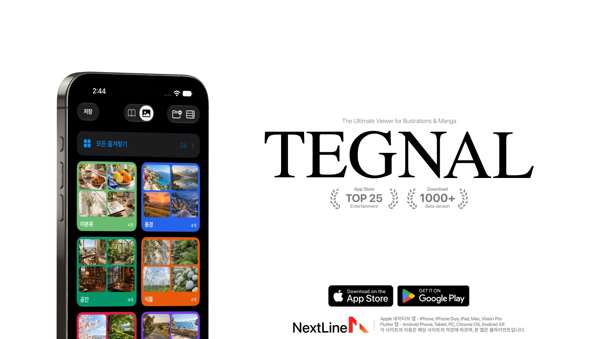
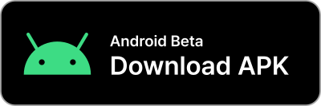

<p align="right"><a href="README.md">한국어</a></p>

<p align="center">
  <a href="https://testflight.apple.com/join/gnkqu44W">
    
  </a>
</p>

<p align="center">
  <a href="https://testflight.apple.com/join/gnkqu44W"><picture><source media="(max-width: 767px)" srcset="docs/assets/readme/Down_button_en_mobile.svg"></picture></a>
  <a href="https://discord.gg/vUTGZNMaMB"><picture><source media="(max-width: 767px)" srcset="docs/assets/readme/Discord_button_en_mobile.svg"></picture></a>
</p>

<p align="center">
  <a href="https://github.com/nextline-ai/tegnal/releases/download/android-v1.0.0-beta.5/TEGNAL-1.0.0-beta.5-android-arm64.apk"><picture><source media="(max-width: 767px)" srcset="docs/assets/readme/Android_button_en_mobile.svg"></picture></a>
</p>

# TEGNAL

Comics and illustrations, in one app.

A switch at the top of the screen moves you between comic sites like Hitomi and image boards like Danbooru, Gelbooru and Moebooru. No site comes built in. You connect the addresses you already use, and TEGNAL shows their works in its own screens.

The Apple version is on TestFlight and the Android beta is an APK. Both are free.

## Viewing

Read comics page by page or as one long scroll. A work opens straight away, or you can have its details show first. In image mode you can browse several Booru servers together and view full-size images, GIFs, videos, pools and notes without leaving the app.

The translate button in the viewer reads the text inside an image and translates it on your device. Tapping an artist shows their work in every language. Pick one and the next artist opens in that language too.

Image mode also has Challenge Roulette, which is a different sort of thing: spin for a gesture drawing exercise or a mission you wrote yourself, then draw against a timer with a reference image beside you.

## Saving and sorting

Hold a work to save it. You choose the default folder in Settings, and the notice that appears after saving lets you change it on the spot. Remove a bookmark by accident and saving it again before you quit the app puts it back where it was.

A work can sit in several folders. Search your saved works for a tag like `language:korean` and turn the results into a folder, or add an automatic classification rule so new saves file themselves. Each rule can exclude the tags you don't want.

Hold a saved work to find others with a similar composition, palette and style.

## Smart and Recap

Smart picks what to show next from what you saved, what you lingered on and what you finished. Every pick says why it's there. You can hide what you don't care for, ask for more like something, and turn individual tags up or down. You also decide how far it strays from your usual taste.

Recap is a magazine made from your month, one issue at a time. Each issue has its own cover illustration, and inside are your top charts, the artists you kept returning to, the tastes you picked up and the time you spent. It digs up saves you'd forgotten, and past issues stay on your shelf. Share cards never include your saved works, so they're safe to post.

Recommendations, Recap, translation and similar-work search all run on your device. Your viewing history isn't sent to a server to be analyzed.

## Installing

### Apple devices

Runs on iPhone, iPhone Duo, iPad, Mac and Apple Vision Pro, in English, Korean and Japanese.

1. Get [TestFlight](https://apps.apple.com/app/testflight/id899247664) from the App Store.
2. Open the [TEGNAL TestFlight page](https://testflight.apple.com/join/gnkqu44W) and tap Install.

TestFlight is Apple's own app distribution service. There's no computer to connect and no certificate to renew, and updates arrive there too. New versions land on TestFlight first.

Turn on iCloud sync to keep your bookmarks, folders, artists and search history in step across your Apple devices.

<details>
<summary>Installing with AltStore, SideStore or an IPA</summary>

Only some versions are published as IPAs, so these can lag behind TestFlight.

| Method | Link |
| --- | --- |
| AltStore Classic | [Add source](https://nextline-ai.github.io/tegnal/#altstore) |
| SideStore | [Add source](https://nextline-ai.github.io/tegnal/#sidestore) |
| Manual IPA | [Read the guide](https://nextline-ai.github.io/tegnal/manual-install.html) |

To add the source by hand, tap + under Sources and enter:

```text
https://nextline-ai.github.io/tegnal/source.json
```

An IPA has to be re-signed with your own Apple account in the install tool. How often it needs renewing, and which iCloud features work, depends on your account and tool.

</details>

### Android

This is beta 1.0.0-beta.5, for Android 7.0 and later. It isn't on Google Play, so you download the APK yourself.

- [ARM64 APK](https://github.com/nextline-ai/tegnal/releases/download/android-v1.0.0-beta.5/TEGNAL-1.0.0-beta.5-android-arm64.apk): the right one for most recent phones.
- [Universal APK](https://github.com/nextline-ai/tegnal/releases/download/android-v1.0.0-beta.5/TEGNAL-1.0.0-beta.5-android.apk): covers 32-bit ARM, ARM64 and x86-64, if you're not sure what your device uses.

Open the file to install it. If Android asks, allow installs from the browser or file app you downloaded it with, and nothing else. To update, install the new APK the same way. Changes and file hashes are on the [release page](https://github.com/nextline-ai/tegnal/releases/tag/android-v1.0.0-beta.5).

It's a beta, and it doesn't match the Apple version yet. There's no iCloud sync, similar-work search, default save folder or automatic classification, and Smart is still the older version. Image translation hands off to the Google Translate app. Google Drive sync is currently off.

## Getting started

Open the app, tap Enter Website Address and type the address of a site you use, or pick one from the suggestions. TEGNAL finds that site's data and image servers and remembers them, and only looks again if you change the address or a connection fails.

Coming from another app? Import your backup in Settings. TEGNAL reads Violet's `user.db` and `data.db` and Anime Boxes' `.abbj` files, then fills in missing covers, titles and tags from the connected site.

To back up TEGNAL itself, go to Library Management under Settings or More and choose the JSON backup export. Your comics library, image library and challenges all go into one `tegnal-backup.json`, and the same screen restores both modes. Media, caches and sign-in details are left out.

## If a site won't connect

- If a Cloudflare-style check blocks you, tap Validate Client on the error screen or in the server settings and complete it.
- If that doesn't help, turn on Use Embedded Browser in Settings. It opens the site itself instead of the app's screens.
- Danbooru's free accounts can only search two tags at a time, by site policy. Gelbooru and others don't have this limit.

## Development

The iOS app lives in `native-ios/TEGNAL`. Open `native-ios/TEGNAL.xcodeproj` and choose the TEGNAL scheme. It needs iOS 17 or later.

- App bundle ID: `work.nextline.tegnal`
- Share extension ID: `work.nextline.tegnal.share`
- iCloud container: `iCloud.work.nextline.tegnal`

Signing and distributing to devices takes an Apple Developer setup and provisioning profiles for these identifiers. Different identifiers install as a separate app. Source code always reaches GitHub first.

## Contact

<picture>
  <source media="(prefers-color-scheme: dark)" srcset="docs/assets/nextline-logo-dark.svg">
  
</picture>

Bug reports and ideas are welcome on [Discord](https://discord.gg/vUTGZNMaMB).

NextLine · [nextline.work](https://nextline.work) · [contact@nextline.work](mailto:contact@nextline.work)

<sub>TEGNAL is an independent client, not affiliated with Apple or any site you connect to. · <a href="docs/privacy-policy.md">Privacy Policy</a></sub>
