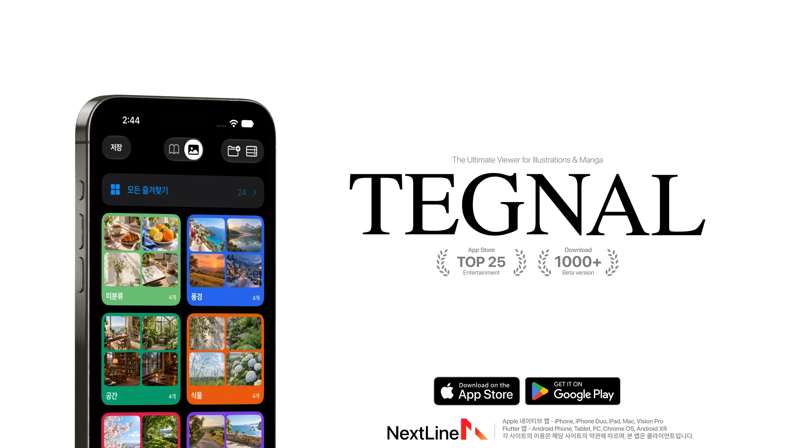

<p align="right"><a href="README.en.md">English</a></p>

<p align="center">
  <a href="https://testflight.apple.com/join/gnkqu44W">
    
  </a>
</p>

<p align="center">
  <a href="https://testflight.apple.com/join/gnkqu44W"><picture><source media="(max-width: 767px)" srcset="docs/assets/readme/Down_button_kr_mobile.svg"></picture></a>
  <a href="https://discord.gg/DFT9Hm66Gz"><picture><source media="(max-width: 767px)" srcset="docs/assets/readme/Discord_button_kr_mobile.svg"></picture></a>
</p>

<p align="center">
  <a href="https://play.google.com/store/apps/details?id=work.nextline.tegnal&hl=ko"></a>
</p>

# TEGNAL

만화와 일러스트를 앱 하나로 봅니다.

화면 위쪽의 전환 버튼을 누르면 만화 사이트와 Booru 계열 이미지 사이트를 바로 오갈 수 있습니다. 앱에 사이트가 들어 있는 것은 아닙니다. 쓰는 사이트의 주소를 연결하면 그 사이트의 작품을 앱 화면으로 보여 줍니다.

Apple 기기용은 TestFlight로, Android용은 Google Play로 배포합니다. 모두 무료입니다.

## 보기

만화는 좌우로 넘기거나 세로로 이어서 읽습니다. 작품을 고르면 바로 열리고, 읽기 전에 작품 정보를 먼저 보도록 바꿀 수도 있습니다. 이미지 모드에서는 여러 Booru 서버를 함께 둘러보고, 고해상도 이미지와 GIF, 동영상, 풀, 노트까지 앱 안에서 봅니다.

뷰어에서 번역 버튼을 누르면 이미지 속 글자를 기기 안에서 읽어 번역합니다. 작가를 누르면 모든 언어의 작품이 나오고, 원하는 언어를 고르면 다음 작가부터 그 언어로 열립니다.

이미지 모드의 챌린지 룰렛은 조금 다른 기능입니다. 크로키 연습이나 직접 만든 미션을 룰렛으로 뽑고, 참고 이미지를 보며 타이머에 맞춰 그릴 수 있습니다.

## 저장하고 정리하기

작품을 길게 누르면 저장됩니다. 저장할 폴더는 설정에서 미리 정할 수 있고, 저장 직후 뜨는 안내에서 바꿀 수도 있습니다. 실수로 해제해도 앱을 끄기 전에 다시 저장하면 원래 폴더로 돌아갑니다.

한 작품을 여러 폴더에 넣을 수 있습니다. 저장 탭에서 `language:korean` 같은 태그로 찾은 결과를 그대로 폴더로 만들 수 있고, 폴더를 길게 눌러 스마트 폴더로 만들면 미분류나 기본 저장 폴더로 들어오는 작품이 태그에 따라 알아서 들어갑니다. 어느 폴더에서 가져올지는 목록에서 고르고, 원하지 않는 태그는 폴더마다 제외할 수 있습니다. 직접 옮긴 작품은 태그가 달라도 그대로 둡니다. 스마트 폴더는 이름 끝에 ✦ 표시가 붙고, 이미지 모드에서도 같은 방식으로 쓸 수 있으며, 규칙은 iCloud로 동기화됩니다.

저장한 작품을 길게 누르면 구도와 색감, 화풍이 비슷한 작품도 찾아 줍니다.

## 스마트 추천과 리캡

스마트 추천은 무엇을 저장했고, 무엇을 오래 봤고, 무엇을 끝까지 읽었는지를 보고 다음 작품을 고릅니다. 작품마다 추천된 이유가 붙어 있고, 관심 없는 작품은 숨기고, 비슷한 작품을 더 달라고 하고, 태그별로 더 보거나 덜 보도록 직접 조정할 수 있습니다. 익숙한 작품 위주로 볼지, 낯선 작품까지 넓힐지도 고를 수 있습니다.

리캡은 매달 한 권씩 나오는 나만의 잡지입니다. 호마다 표지 그림이 다르고, 안에는 그달의 탑 차트와 많이 본 작가, 새로 빠진 취향, 감상 시간이 담깁니다. 잊고 있던 저장작을 다시 만나기도 하고, 지난 호는 서가에 쌓입니다. 공유 카드에는 저장한 작품이 들어가지 않으니 안심하고 올려도 됩니다.

추천과 리캡, 번역, 비슷한 그림 찾기는 모두 기기 안에서 처리합니다. 감상 기록을 분석하려고 외부 서버로 보내지 않습니다.

## 설치

### Apple 기기

iPhone, iPhone Duo, iPad, Mac, Apple Vision Pro에서 쓸 수 있고 한국어, 영어, 일본어를 지원합니다.

1. App Store에서 [TestFlight](https://apps.apple.com/kr/app/testflight/id899247664)를 받습니다.
2. [TEGNAL TestFlight 페이지](https://testflight.apple.com/join/gnkqu44W)를 열고 설치를 누릅니다.

TestFlight는 Apple이 운영하는 앱 배포 서비스입니다. PC를 연결하거나 인증서를 갱신할 필요가 없고, 업데이트도 TestFlight에서 받습니다. 새 버전은 여기에 가장 먼저 올라옵니다.

iCloud 동기화를 켜면 북마크, 폴더, 작가, 검색 기록이 내 Apple 기기끼리 이어집니다.

<details>
<summary>AltStore, SideStore, IPA로 설치하기</summary>

IPA는 일부 버전만 올리기 때문에 TestFlight보다 버전이 낮을 수 있습니다.

| 방법 | 링크 |
| --- | --- |
| AltStore Classic | [소스 등록](https://nextline-ai.github.io/tegnal/#altstore) |
| SideStore | [소스 등록](https://nextline-ai.github.io/tegnal/#sidestore) |
| IPA 수동 설치 | [안내 보기](https://nextline-ai.github.io/tegnal/manual-install.html) |

직접 등록하려면 Sources에서 + 를 누르고 아래 주소를 넣습니다.

```text
https://nextline-ai.github.io/tegnal/source.json
```

IPA는 설치 도구에서 자신의 Apple 계정으로 다시 서명해야 합니다. 서명 갱신 주기와 쓸 수 있는 iCloud 기능은 계정과 도구에 따라 다릅니다.

</details>

### Android

[Google Play](https://play.google.com/store/apps/details?id=work.nextline.tegnal&hl=ko)에서 설치합니다. Android 7.0 이상에서 쓸 수 있고, 업데이트도 Google Play로 받습니다.

<details>
<summary>예전 베타 APK</summary>

Google Play 정식 출시 전에 배포한 베타 APK는 더 이상 갱신하지 않습니다. 자동 업데이트를 받을 수 없으니 특별한 이유가 없다면 Google Play 버전을 쓰세요. 파일은 [릴리스 페이지](https://github.com/nextline-ai/tegnal/releases/tag/android-v1.0.0-beta.5)에 남겨 두었습니다.

</details>

## 처음 시작할 때

앱을 열고 주소 입력을 누른 뒤 쓰는 사이트 주소를 넣습니다. 자동완성 목록에서 골라도 됩니다. 앱이 그 주소에서 데이터와 이미지 서버를 찾아 저장하고, 주소를 바꾸거나 연결에 실패했을 때만 다시 찾습니다.

다른 앱을 쓰고 있었다면 설정에서 백업을 가져옵니다. Violet의 `user.db`, `data.db`와 Anime Boxes의 `.abbj` 파일을 읽을 수 있습니다. 빠진 표지와 제목, 태그는 연결된 사이트에서 자동으로 채웁니다.

TEGNAL 자체 백업은 설정이나 더보기의 보관함 관리에서 JSON 백업 내보내기를 누르면 됩니다. 만화와 이미지 보관함, 챌린지를 `tegnal-backup.json` 하나에 담고, 같은 화면에서 두 모드를 함께 복원합니다. 이미지와 캐시, 로그인 정보는 들어가지 않습니다.

## 연결이 안 될 때

- Cloudflare 같은 확인 화면에 막히면 오류 화면이나 서버 설정에서 클라이언트 확인을 눌러 절차를 마칩니다.
- 그래도 안 되면 설정에서 내장 브라우저 사용을 켭니다. 앱 화면 대신 사이트를 그대로 엽니다.
- 일부 이미지 사이트는 무료 계정으로 태그를 두 개까지만 검색할 수 있습니다. 사이트 정책이라 앱에서 바꿀 수 없습니다.

## 개발

iOS 앱은 `native-ios/TEGNAL`에 있습니다. `native-ios/TEGNAL.xcodeproj`를 열고 TEGNAL 스킴을 고르면 됩니다. 최소 버전은 iOS 17입니다.

- 앱 번들 ID: `work.nextline.tegnal`
- 공유 확장 ID: `work.nextline.tegnal.share`
- iCloud 컨테이너: `iCloud.work.nextline.tegnal`

실기기 서명과 배포에는 이 식별자를 쓰는 Apple Developer 설정과 프로비저닝 프로파일이 필요합니다. 식별자가 다르면 기존 설치와 별개의 앱으로 설치됩니다. 소스 코드는 항상 GitHub에 먼저 올라옵니다.

## 문의

<picture>
  <source media="(prefers-color-scheme: dark)" srcset="docs/assets/nextline-logo-dark.svg">
  
</picture>

버그 제보와 기능 제안은 [Discord](https://discord.gg/DFT9Hm66Gz)에 남겨 주세요.

NextLine · [nextline.work](https://nextline.work) · [contact@nextline.work](mailto:contact@nextline.work)

<sub>TEGNAL은 Apple 및 연결하는 외부 사이트와 관계없는 독립 클라이언트입니다. · <a href="docs/privacy-policy.md">개인정보처리방침</a></sub>
